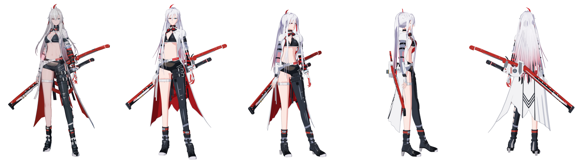

# Alpha (Crimson Weave) — modelo 3D

Modelo 3D em estilo anime da Alpha, visual Crimson Weave, de
*Punishing: Gray Raven*, a partir da imagem de referência
(`reference/reference.png`): cabelo prateado longo com o enfeite vermelho em
forma de meia-lua, olhos heterocromáticos (vermelho à direita dela, ciano à
esquerda), coleira alta com óculos, biquíni preto, casaco branco aberto com
forro carmim e caudas longas, shorts de couro, perneira armada na perna
esquerda, cinta branca na coxa direita, botas pretas, braçadeira com
bandagens vermelhas e pretas, luvas e as três espadas.



## Arquivos

| Arquivo | Para quê |
| --- | --- |
| `export/personagem.blend` | Cena editável do Blender 4.5: modelo com rig, materiais toon (sombra em degrau + contorno), luz e câmeras. A câmera `RefCam` reproduz o enquadramento da imagem de referência. |
| `export/personagem.glb` | glTF 2.0 completo (885 mil triângulos), com esqueleto e pesos. Abre em Blender, Unity (glTFast/UniVRM), Godot, three.js, visualizadores online. |
| `export/personagem.fbx` | FBX com esqueleto e textura embutida, para Unity/Unreal/Maya. |
| `export/personagem_web.glb` | Versão leve (609 mil triângulos, compressão Draco, 2,7 MB) usada pelo visualizador web. |
| `viewer/` | Visualizador three.js com sombreamento toon, contorno, vistas e poses. Para abrir localmente: `python3 -m http.server` dentro da pasta e acesse `http://localhost:8000`. |
| `renders/` | Renders do Blender (EEVEE) usados na comparação. |
| `src/` | Todo o código que gera o modelo (ver abaixo). |

Medidas: 1,68 m de altura (sem o enfeite do cabelo), em metros, Z para cima
no Blender, personagem olhando para −Y.

### Rig

22 ossos com nomes humanoides (`Hips`, `Spine`, `Chest`, `UpperChest`, `Neck`,
`Head`, `Shoulder/UpperArm/LowerArm/Hand.L/.R`, `UpperLeg/LowerLeg/Foot/Toes.L/.R`).
A pose de repouso é a pose da imagem (não é T-pose). As espadas da mão e o
punho seguem `Hand.R`; as espadas das costas seguem `Hips`; o cabelo longo
distribui o peso entre `Head` e o tronco.

### Materiais

Cada material tem uma cor iluminada, uma cor de sombra e uma cor de contorno
(`export/palette.json`). No `.blend` o visual toon usa *Shader to RGB* no
EEVEE e contorno por casco invertido (modificador `Outline`). No glTF/FBX os
materiais são PBR simples com essas cores-base; o visualizador web reaplica o
toon.

## Como foi feito

Tudo é gerado por código, sem esculpir à mão (Python + Blender 4.5):

1. **Medidas da referência.** Os pontos do esqueleto (ombros, cotovelos,
   quadril, joelhos...) foram medidos em pixels na imagem e convertidos para
   metros (`src/rig.py`, 1,85 mm por pixel). O tronco está girado ~20° para a
   direita dela, como na arte.
2. **Corpo e cabeça por campos de distância (SDF)** transformados em malha
   com *marching cubes*, com normais suavizadas para o toon não ficar
   manchado (`src/sdf.py`, `src/body.py`, `src/normals.py`).
3. **Rosto.** Olhos, cílios, sobrancelhas e boca pintados numa textura
   projetada de frente (`src/face_texture.py`); a cabeça usa normais de um
   elipsoide para a sombra do rosto ficar limpa.
4. **Cabelo.** Mechas em forma de crescente com normais "de massa" (sombra
   em blocos, como em anime), rabo de cavalo alto e pontas rosa → vermelho
   (`src/hair.py`, `src/hair_texture.py`).
5. **Roupas.** Cada peça é um contorno 2D projetado sobre o corpo por raios,
   com espessura e borda dura (`src/outfit.py`, `src/clothing_geo.py`).
   O casaco tem jaqueta curta, lapelas, gola alta, saia com pregas, aba longa
   em ponta e o gráfico das costas (`src/coat.py`).
6. **Peças rígidas** (fivelas, anéis, óculos, botas, espadas, suporte das
   costas) são polígonos com chanfro e arestas vivas (`src/hardsurf.py`,
   `src/accessories.py`, `src/boots.py`, `src/swords.py`, `src/hands.py`).
7. **Sombreamento toon v2** (`src/toon2.py`): três tons (luz, sombra,
   sombra profunda), oclusão de contato calculada por raios e guardada na
   malha, brilho duro e luz de borda. O visualizador web usa a mesma conta.
8. **Cena, rig e exportação** em `src/scene.py`, `src/rigging.py` e
   `src/export.py`. O rig escolhe os ossos pelo nome de cada objeto.

As peças de roupa, casaco, botas, acessórios, espadas e mãos foram feitas
cada uma por um agente, revisadas por outro agente contra as referências
oficiais e refinadas. Pesquisa de referências: `docs/research.json`;
o que falta melhorar: `HANDOFF.md`.

### Gerar de novo

Requer o Blender 4.5 e, no Python do Blender, `scipy`, `scikit-image` e
`pillow`.

```bash
cd modelo-personagem/src
PY=<pasta do blender>/4.5/python/bin/python3.11
$PY face_texture.py                 # textures/face.png
$PY hair_texture.py                 # textures/hair.png, hair_tail.png
$PY build_parts.py                  # malhas em ../cache (~2 min)
./preview.sh /tmp/prev ref,three    # renders rápidos para conferir
blender -b -P export.py -- --rig --renders
$PY compare.py ../renders/ref.png /tmp/cmp.png   # sobreposição com a referência
```

## Limitações

- O rosto é uma textura projetada: fica melhor de frente e de três quartos.
- As botas estão um pouco baixas e largas, e a perna direita é reta demais
  (ver `HANDOFF.md` para a lista completa, em ordem de prioridade).
- O gráfico das costas do casaco é estimado a partir de imagens do jogo em
  baixa resolução.
- O rig não tem dedos nem ossos de cabelo/casaco; esses acompanham a mão,
  a cabeça e o quadril.
